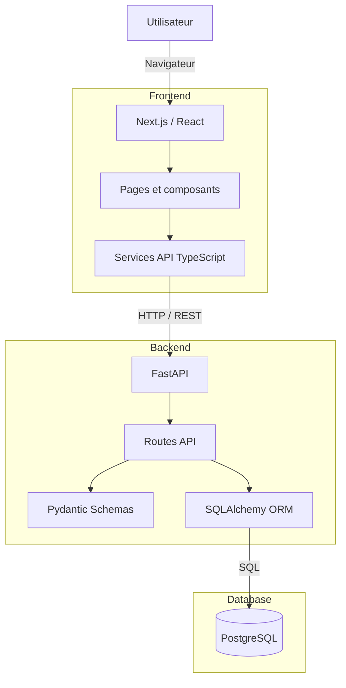

# Architecture du MVP

## Architecture générale



## Flux principal

L'utilisateur interagit avec l'interface développée avec **Next.js, React et TypeScript**.

Le frontend communique avec **FastAPI** via une API REST. FastAPI valide les données avec **Pydantic**, puis utilise **SQLAlchemy** pour communiquer avec la base **PostgreSQL**.

Le flux général est donc :

```text
Utilisateur
    ↓
Next.js / React
    ↓
Services API TypeScript
    ↓ HTTP
FastAPI
    ↓
Pydantic / SQLAlchemy
    ↓
PostgreSQL
```
