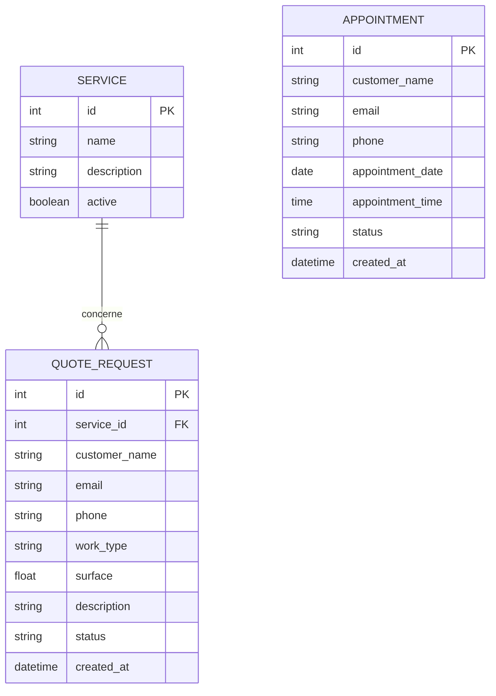

# Schéma de la base de données

Le MVP utilise trois entités principales : `Service`, `QuoteRequest` et `Appointment`.

## Relations

Une demande de devis (`QuoteRequest`) est associée à un service (`Service`) grâce à la clé étrangère `service_id`.

Les rendez-vous (`Appointment`) sont indépendants des demandes de devis dans le MVP actuel.
